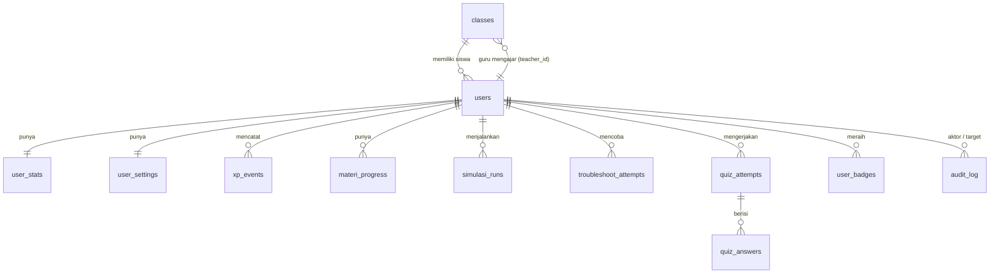

# DATABASE — SinyalLab

Pendamping `PRD_SinyalLab.md` dan `ARCHITECTURE.md`. Dokumen ini mendefinisikan **skema database, sistem login (nama kelas + password), keamanan, dan sinkronisasi** untuk data pengguna.

> **Dampak besar:** PRD sebelumnya mengasumsikan *tanpa login dan tanpa backend* (A2). Dengan adanya akun, asumsi itu **diganti**. Lihat Bagian 12 untuk daftar bagian PRD/ARCHITECTURE yang harus diperbarui.

---

## 1. Keputusan Utama

| # | Keputusan | Alasan |
|---|-----------|--------|
| D1 | **PostgreSQL lewat Supabase** (Postgres + Auth + Row Level Security + Edge Functions) | SQL standar, gratis untuk skala kelas/sekolah, RLS menjaga data antar siswa, tidak perlu menulis server sendiri |
| D2 | **Offline-first tetap berlaku.** Login hanya perlu sekali, lalu aplikasi tetap berjalan tanpa internet. Data disinkronkan saat online | Sinyal siswa sering buruk (lihat PRD §2) |
| D3 | **Konten edukasi tetap di JSON dalam aplikasi, bukan di database.** Database hanya menyimpan *progres* yang merujuk ke ID konten (`section_id`, `case_id`, `question_id`) | ARCHITECTURE §6. ID konten harus stabil |
| D4 | **Akun siswa dibuat oleh guru**, bukan pendaftaran mandiri | Mencegah akun sembarangan, memudahkan data per kelas |
| D5 | **Data pribadi minimal**: hanya nama tampilan dan username. Tanpa email siswa, tanpa no. HP, tanpa tanggal lahir | Pengguna sebagian besar anak di bawah 18 tahun |
| D6 | **Log XP bersifat append-only** (`xp_events`), total XP didenormalisasi di `user_stats` | Bisa diaudit, aman dari sinkronisasi ganda |

### Desain Login (Dasar Keputusan)

Permintaan: *"login pakai nama kelas dan password."* Agar tiap siswa punya progres sendiri, form login memakai **tiga isian**:

| Isian | Contoh | Keterangan |
|-------|--------|------------|
| Nama Kelas | `XI TAV 1` | Dicocokkan tanpa peduli huruf besar/kecil, spasi, dan tanda baca (`xi-tav-1` = `XI TAV 1`) |
| Nama / No. Absen | `07` atau `Budi` | Unik di dalam satu kelas |
| Password | `••••••` | Milik masing-masing siswa |

**Alternatif jika benar-benar hanya dua isian** (nama kelas + satu password bersama): siswa memilih namanya dari daftar kelas setelah masuk. Ini jauh kurang aman (siapa pun yang tahu password kelas bisa memakai akun teman) dan **tidak direkomendasikan**. Skema di bawah mendukung kedua mode. Perbedaannya hanya di alur Edge Function `student-login`.

---

## 2. Diagram Relasi (ER)



Tabel pendukung tanpa relasi ke pengguna: `login_attempts` (pembatas percobaan login).

---

## 3. Pemetaan ke Data Lokal (PRD §13)

| Field `Progress` di PRD | Tabel |
|-------------------------|-------|
| `profile` (nickname, dailyGoalXp) | `users.display_name`, `user_stats.daily_goal_xp` |
| `xp` | `xp_events` (log) + `user_stats.xp_total` |
| `streak` | `user_stats.streak_*` |
| `materi` | `materi_progress` |
| `simulasi` | `simulasi_runs` |
| `troubleshoot` | `troubleshoot_attempts` + view `troubleshoot_progress` |
| `quiz` (best, history) | `quiz_attempts` + `quiz_answers` + view `quiz_best` |
| `badges` | `user_badges` |
| `settings` | `user_settings` |

---

## 4. Skema SQL (Salin ke `supabase/migrations/0001_init.sql`)

```sql
-- =====================================================================
-- SinyalLab — 0001_init.sql  (PostgreSQL 15+, Supabase)
-- =====================================================================
create extension if not exists pgcrypto;

-- ---------- Tipe ----------
create type user_role          as enum ('student', 'teacher', 'admin');
create type app_mode           as enum ('AM', 'FM');
create type xp_source          as enum (
  'materi_card', 'materi_quickcheck', 'materi_section',
  'simulasi_run', 'troubleshoot_case', 'quiz_correct', 'quiz_pass'
);
create type font_scale         as enum ('S', 'M', 'L');
create type quiz_feedback_mode as enum ('perQuestion', 'end');

-- ---------- Util ----------
create function set_updated_at() returns trigger
language plpgsql as $$
begin
  new.updated_at = now();
  return new;
end $$;

-- ---------- Kelas ----------
create table classes (
  id          uuid primary key default gen_random_uuid(),
  name        text not null check (length(btrim(name)) between 2 and 40),
  -- kunci pencocokan login: huruf kecil, hanya a-z dan 0-9 ("XI TAV 1" -> "xitav1")
  name_key    text generated always as (regexp_replace(lower(name), '[^a-z0-9]', '', 'g')) stored,
  school_year text,                       -- contoh: '2026/2027'
  teacher_id  uuid,                       -- FK ditambahkan setelah tabel users ada
  is_active   boolean not null default true,
  created_at  timestamptz not null default now(),
  updated_at  timestamptz not null default now(),
  constraint classes_name_key_not_empty check (name_key <> '')
);
-- Nama kelas harus unik di antara kelas yang AKTIF (nama sama boleh dipakai ulang tahun ajaran berikutnya)
create unique index classes_active_name_key_uq on classes (name_key) where is_active;
create trigger classes_updated before update on classes
  for each row execute function set_updated_at();

-- ---------- Pengguna (profil aplikasi; kredensial di auth.users milik Supabase) ----------
create table users (
  id                   uuid primary key references auth.users(id) on delete cascade,
  role                 user_role not null,
  class_id             uuid references classes(id) on delete restrict,
  username             text not null check (length(btrim(username)) between 1 and 30),
  username_key         text generated always as (lower(btrim(username))) stored,
  display_name         text not null check (length(btrim(display_name)) between 1 and 60),
  is_active            boolean not null default true,
  must_change_password boolean not null default true,
  created_by           uuid references users(id) on delete set null,
  last_login_at        timestamptz,
  created_at           timestamptz not null default now(),
  updated_at           timestamptz not null default now(),
  constraint student_needs_class check (role <> 'student' or class_id is not null)
);
-- username siswa unik dalam satu kelas
create unique index users_class_username_uq on users (class_id, username_key) where role = 'student';
create index users_class_idx on users (class_id);
create trigger users_updated before update on users
  for each row execute function set_updated_at();

alter table classes
  add constraint classes_teacher_fk
  foreign key (teacher_id) references users(id) on delete set null;

-- ---------- Statistik ringkas (XP, level, streak) ----------
create table user_stats (
  user_id               uuid primary key references users(id) on delete cascade,
  xp_total              integer not null default 0 check (xp_total >= 0),
  level                 integer generated always as (xp_total / 200 + 1) stored,  -- PRD §7.2
  daily_goal_xp         smallint not null default 30 check (daily_goal_xp in (20, 30, 50)),
  streak_current        integer not null default 0 check (streak_current >= 0),
  streak_longest        integer not null default 0 check (streak_longest >= 0),
  streak_last_goal_date date,
  streak_freeze_week    text,            -- contoh '2026-W45' (freeze gratis 1x/minggu)
  updated_at            timestamptz not null default now()
);
create trigger user_stats_updated before update on user_stats
  for each row execute function set_updated_at();

-- ---------- Pengaturan ----------
create table user_settings (
  user_id             uuid primary key references users(id) on delete cascade,
  sound               boolean not null default true,
  haptics             boolean not null default true,
  font_scale          font_scale not null default 'M',
  quiz_feedback_mode  quiz_feedback_mode not null default 'perQuestion',
  hearts_enabled      boolean not null default false,   -- PRD A4
  notifications       boolean not null default false,
  updated_at          timestamptz not null default now()
);
create trigger user_settings_updated before update on user_settings
  for each row execute function set_updated_at();

-- Baris stats & settings dibuat otomatis untuk setiap pengguna baru
create function init_user_rows() returns trigger
language plpgsql security definer set search_path = public as $$
begin
  insert into user_stats (user_id)    values (new.id);
  insert into user_settings (user_id) values (new.id);
  return new;
end $$;
create trigger users_init after insert on users
  for each row execute function init_user_rows();

-- ---------- Log XP (append-only) ----------
create table xp_events (
  id              uuid primary key default gen_random_uuid(),
  user_id         uuid not null references users(id) on delete cascade,
  client_event_id uuid not null,                 -- dibuat di perangkat; kunci idempotensi sync
  source          xp_source not null,
  amount          integer not null check (amount > 0),
  ref_id          text,                          -- section_id / case_id / question_id terkait
  local_date      date not null,                 -- tanggal lokal perangkat (untuk target harian & streak)
  occurred_at     timestamptz not null,          -- waktu kejadian di perangkat
  received_at     timestamptz not null default now(),
  unique (user_id, client_event_id)
);
create index xp_events_user_date_idx on xp_events (user_id, local_date);

create function apply_xp_event() returns trigger
language plpgsql security definer set search_path = public as $$
begin
  update user_stats
     set xp_total = xp_total + new.amount
   where user_id = new.user_id;
  return new;
end $$;
create trigger xp_events_apply after insert on xp_events
  for each row execute function apply_xp_event();

-- ---------- Progres materi ----------
create table materi_progress (
  user_id              uuid not null references users(id) on delete cascade,
  section_id           text not null,
  cards_seen           text[] not null default '{}',
  completed            boolean not null default false,
  quickcheck_first_try boolean,                  -- null = belum dijawab
  completed_at         timestamptz,
  updated_at           timestamptz not null default now(),
  primary key (user_id, section_id)
);
create trigger materi_progress_updated before update on materi_progress
  for each row execute function set_updated_at();

-- ---------- Simulasi ----------
create table simulasi_runs (
  id               uuid primary key default gen_random_uuid(),
  user_id          uuid not null references users(id) on delete cascade,
  client_event_id  uuid not null,
  mode             app_mode not null,
  station_id       text,                         -- contoh 'am-828', 'fm-98.0'
  inspected_blocks text[] not null default '{}', -- ['ANT','TUN','IF',...]
  completed        boolean not null default false,
  local_date       date not null,
  created_at       timestamptz not null,
  unique (user_id, client_event_id)
);
create index simulasi_runs_user_idx on simulasi_runs (user_id, created_at desc);

-- ---------- Troubleshooting ----------
create table troubleshoot_attempts (
  id               uuid primary key default gen_random_uuid(),
  user_id          uuid not null references users(id) on delete cascade,
  client_event_id  uuid not null,
  case_id          text not null,                -- contoh 'case-01'
  measured_blocks  text[] not null default '{}', -- blok unik yang diukur, berurutan
  measurements     smallint not null default 0 check (measurements >= 0),
  wrong_guesses    smallint not null default 0 check (wrong_guesses >= 0),
  hints_used       smallint not null default 0 check (hints_used between 0 and 2),
  solved           boolean not null default false,
  stars            smallint not null default 0 check (stars between 0 and 3),
  xp_awarded       integer not null default 0 check (xp_awarded >= 0),
  started_at       timestamptz not null,
  finished_at      timestamptz,
  unique (user_id, client_event_id)
);
create index troubleshoot_attempts_user_case_idx on troubleshoot_attempts (user_id, case_id);

-- ---------- Kuis ----------
create table quiz_attempts (
  id               uuid primary key default gen_random_uuid(),
  user_id          uuid not null references users(id) on delete cascade,
  client_event_id  uuid not null,
  total_questions  smallint not null check (total_questions > 0),
  correct_count    smallint not null check (correct_count >= 0),
  score            smallint not null check (score between 0 and 100),
  kkm              smallint not null default 75 check (kkm between 0 and 100),
  passed           boolean not null,
  feedback_mode    quiz_feedback_mode not null,
  by_topic         jsonb not null default '{}',  -- {"IF":{"correct":2,"total":3}, ...}
  started_at       timestamptz not null,
  finished_at      timestamptz not null,
  unique (user_id, client_event_id),
  constraint quiz_correct_lte_total check (correct_count <= total_questions)
);
create index quiz_attempts_user_idx on quiz_attempts (user_id, finished_at desc);

create table quiz_answers (
  attempt_id       uuid not null references quiz_attempts(id) on delete cascade,
  question_id      text not null,
  topic            text not null,
  position         smallint not null,            -- urutan soal di sesi tsb
  selected_index   smallint,                     -- indeks opsi ASLI di JSON (bukan posisi setelah diacak); null = tak dijawab
  correct_index    smallint not null,
  is_correct       boolean not null,
  primary key (attempt_id, question_id)
);

-- ---------- Badge ----------
create table user_badges (
  user_id      uuid not null references users(id) on delete cascade,
  badge_id     text not null,
  unlocked_at  timestamptz not null,
  primary key (user_id, badge_id)
);

-- ---------- Keamanan: percobaan login & audit ----------
create table login_attempts (
  id            bigint generated always as identity primary key,
  class_key     text not null,
  username_key  text not null,
  ip            inet,
  success       boolean not null,
  created_at    timestamptz not null default now()
);
create index login_attempts_lookup_idx on login_attempts (class_key, username_key, created_at desc);

create table audit_log (
  id              bigint generated always as identity primary key,
  actor_id        uuid references users(id) on delete set null,
  target_user_id  uuid references users(id) on delete set null,
  action          text not null,   -- 'create_student','reset_password','deactivate_user','deactivate_class','reset_progress'
  meta            jsonb not null default '{}',
  created_at      timestamptz not null default now()
);
create index audit_log_target_idx on audit_log (target_user_id, created_at desc);

-- ---------- View turunan (progres per kasus, nilai terbaik, ikhtisar kelas) ----------
create view troubleshoot_progress with (security_invoker = true) as
select user_id,
       case_id,
       count(*)                       as attempts,
       bool_or(solved)                as solved,
       coalesce(max(stars), 0)        as best_stars,
       min(finished_at) filter (where solved) as first_solved_at
  from troubleshoot_attempts
 group by user_id, case_id;

create view quiz_best with (security_invoker = true) as
select user_id,
       max(score)        as best_score,
       count(*)          as attempts,
       max(finished_at)  as last_attempt_at
  from quiz_attempts
 group by user_id;

-- Ikhtisar untuk guru (dashboard guru ada di luar MVP, datanya sudah siap)
create view class_overview with (security_invoker = true) as
select u.id as user_id,
       u.class_id,
       u.display_name,
       u.username,
       s.xp_total,
       s.level,
       s.streak_current,
       (select count(*) from materi_progress m where m.user_id = u.id and m.completed)      as sections_done,
       (select count(*) from troubleshoot_progress t where t.user_id = u.id and t.solved)   as cases_solved,
       (select best_score from quiz_best q where q.user_id = u.id)                          as quiz_best,
       greatest(
         (select max(received_at) from xp_events x where x.user_id = u.id),
         u.last_login_at
       ) as last_active_at
  from users u
  join user_stats s on s.user_id = u.id
 where u.role = 'student';

-- ---------- Fungsi bantu keamanan ----------
create function auth_role() returns user_role
language sql stable security definer set search_path = public as $$
  select role from users where id = auth.uid()
$$;

create function teaches_student(target uuid) returns boolean
language sql stable security definer set search_path = public as $$
  select exists (
    select 1
      from users s
      join classes c on c.id = s.class_id
     where s.id = target
       and c.teacher_id = auth.uid()
  )
$$;

-- Reset progres milik sendiri (PRD §12: "Reset progres")
create function reset_my_progress() returns void
language plpgsql security definer set search_path = public as $$
begin
  if auth.uid() is null then
    raise exception 'not authenticated';
  end if;
  delete from xp_events             where user_id = auth.uid();
  delete from materi_progress       where user_id = auth.uid();
  delete from simulasi_runs         where user_id = auth.uid();
  delete from troubleshoot_attempts where user_id = auth.uid();
  delete from quiz_attempts         where user_id = auth.uid();  -- quiz_answers ikut terhapus (cascade)
  delete from user_badges           where user_id = auth.uid();
  update user_stats
     set xp_total = 0, streak_current = 0, streak_longest = 0,
         streak_last_goal_date = null, streak_freeze_week = null
   where user_id = auth.uid();
  insert into audit_log (actor_id, target_user_id, action)
  values (auth.uid(), auth.uid(), 'reset_progress');
end $$;

-- ---------- Row Level Security ----------
alter table classes               enable row level security;
alter table users                 enable row level security;
alter table user_stats            enable row level security;
alter table user_settings         enable row level security;
alter table xp_events             enable row level security;
alter table materi_progress       enable row level security;
alter table simulasi_runs         enable row level security;
alter table troubleshoot_attempts enable row level security;
alter table quiz_attempts         enable row level security;
alter table quiz_answers          enable row level security;
alter table user_badges           enable row level security;
alter table login_attempts        enable row level security;  -- tanpa policy = hanya service role
alter table audit_log             enable row level security;  -- tanpa policy = hanya service role

-- Kelas: siswa melihat kelasnya, guru melihat kelas yang diajarnya, admin semua
create policy classes_select on classes for select using (
  teacher_id = auth.uid()
  or id = (select class_id from users where id = auth.uid())
  or auth_role() = 'admin'
);

-- Pengguna: lihat diri sendiri, siswa di kelas yang diajar, atau admin.
-- Perubahan data pengguna dilakukan lewat Edge Function (service role), bukan langsung dari klien.
create policy users_select on users for select using (
  id = auth.uid()
  or teaches_student(id)
  or auth_role() = 'admin'
);

-- Tabel yang boleh DIUBAH pemiliknya (insert + update)
do $$
declare t text;
begin
  foreach t in array array['user_stats', 'user_settings', 'materi_progress'] loop
    execute format($f$create policy %I on %I for select
                      using (user_id = auth.uid() or teaches_student(user_id) or auth_role() = 'admin')$f$,
                   t || '_select', t);
    execute format($f$create policy %I on %I for insert
                      with check (user_id = auth.uid())$f$, t || '_insert', t);
    execute format($f$create policy %I on %I for update
                      using (user_id = auth.uid()) with check (user_id = auth.uid())$f$, t || '_update', t);
  end loop;
end $$;

-- Tabel APPEND-ONLY (hanya insert + select, tanpa update/delete dari klien)
do $$
declare t text;
begin
  foreach t in array array['xp_events', 'simulasi_runs', 'troubleshoot_attempts', 'quiz_attempts', 'user_badges'] loop
    execute format($f$create policy %I on %I for select
                      using (user_id = auth.uid() or teaches_student(user_id) or auth_role() = 'admin')$f$,
                   t || '_select', t);
    execute format($f$create policy %I on %I for insert
                      with check (user_id = auth.uid())$f$, t || '_insert', t);
  end loop;
end $$;

-- Jawaban kuis: mengikuti kepemilikan attempt
create policy quiz_answers_select on quiz_answers for select using (
  exists (select 1 from quiz_attempts a
           where a.id = attempt_id
             and (a.user_id = auth.uid() or teaches_student(a.user_id) or auth_role() = 'admin'))
);
create policy quiz_answers_insert on quiz_answers for insert with check (
  exists (select 1 from quiz_attempts a
           where a.id = attempt_id and a.user_id = auth.uid())
);
```

**Catatan SQL**
- Setelah migrasi, jalankan test RLS (Bagian 10) sebelum membuat akun nyata.
- `xp_events`, `simulasi_runs`, dan seterusnya sengaja **tanpa policy update/delete** agar klien tidak bisa mengubah riwayat. Satu-satunya penghapusan massal lewat `reset_my_progress()`.
- Memakai `auth.users` (milik Supabase) untuk kredensial. **Kata sandi tidak pernah disimpan di tabel kita.**

---

## 5. Alur Autentikasi

### 5.1 Mengapa Edge Function
Supabase Auth bawaannya memakai email + password. Siswa tidak punya email, jadi:
- Saat guru membuat akun siswa, Edge Function membuat entri di `auth.users` dengan **email sintetis** `"<user_id>@siswa.sinyallab.invalid"` (domain `.invalid` tidak bisa menerima surat, tidak ada email yang pernah dikirim). Email konfirmasi dimatikan.
- Siswa **tidak pernah melihat** email ini. Aplikasi memanggil Edge Function `student-login`, yang mencari `user_id` dari (nama kelas, username) lalu melakukan sign-in dengan email sintetis tersebut.

### 5.2 Edge Functions (service role, tidak bisa dipanggil sembarang dari klien)

| Function | Pemanggil | Tugas |
|----------|-----------|-------|
| `student-login` | Siswa (publik, dibatasi) | Input `{ class_name, username, password }`. Normalisasi kunci, cek pembatas percobaan, cari user, sign-in, kembalikan sesi + flag `must_change_password`. Pesan error **selalu generik** ("Kelas, nama, atau password salah"), tidak membocorkan mana yang keliru |
| `create-students` | Guru/admin | Input kelas + daftar siswa (atau CSV: `username,display_name[,password]`). Membuat `auth.users` + baris `users`. Jika password kosong, hasilkan password acak mudah dibaca (6–8 karakter tanpa `0/O/1/l/I`) lalu kembalikan **sekali** untuk dicetak/dibagikan |
| `reset-student-password` | Guru/admin | Mengganti password siswa, set `must_change_password = true`, catat ke `audit_log` |
| `change-my-password` | Siswa | Ganti password sendiri, set `must_change_password = false` |
| `deactivate-class` | Guru/admin | `classes.is_active = false` (akhir tahun ajaran), siswa tidak bisa login baru, data tetap tersimpan |

### 5.3 Aturan Keamanan Login
- **Pembatas percobaan:** ≥ 5 gagal untuk pasangan (class_key, username_key) dalam 15 menit → tolak 15 menit berikutnya (hitung dari `login_attempts`). Tambah pembatas per IP (mis. 30 percobaan/15 menit).
- **Kebijakan password siswa:** minimal 6 karakter, tidak boleh sama dengan username. (Sengaja lebih ringan dari rekomendasi umum 8+ karena pengguna anak sekolah. Dikompensasi pembatas percobaan dan password awal acak dari guru.)
- **Password awal:** siswa **wajib ganti** saat login pertama (`must_change_password`).
- **Lupa password:** tidak ada pemulihan lewat email. Siswa minta guru memakai `reset-student-password`.
- **Sesi:** token disimpan di `expo-secure-store` (bukan MMKV biasa). Masa aktif panjang (mis. 30 hari) dengan refresh otomatis.
- **Akun nonaktif** (`users.is_active = false` atau kelas nonaktif): login ditolak dengan pesan generik.
- Semua aksi sensitif (buat/reset/nonaktifkan) dicatat di `audit_log`.
- Guru/admin login dengan **email + password** biasa (Supabase Auth).

### 5.4 Layar & Perilaku di Aplikasi
1. Layar login: **Nama Kelas**, **Nama / No. Absen**, **Password** (ada tombol tampilkan/sembunyikan). Pesan galat generik.
2. Login pertama → layar wajib ganti password.
3. Setelah login: sesi disimpan, aplikasi **bisa dibuka dan dipakai penuh tanpa internet**.
4. Tombol Keluar di Profil. Saat keluar, data lokal milik pengguna dihapus dari perangkat **setelah** antrean sinkronisasi (outbox) berhasil terkirim, atau setelah konfirmasi jika masih ada data belum terkirim.
5. Beberapa siswa memakai satu HP bergantian: data lokal harus **dipisah per user_id** (namespace storage `u:<user_id>:...`).

---

## 6. Strategi Sinkronisasi (Offline-First)

**Prinsip:** perangkat adalah sumber kejadian, server adalah pengumpul dan penyimpan.

### 6.1 Antrean Kirim (Outbox)
- Setiap kejadian (XP, simulasi selesai, attempt troubleshooting, attempt kuis) dibuat di perangkat dengan `client_event_id` (UUID v4) dan **dimasukkan ke antrean lokal** (MMKV) sebelum apa pun.
- Pengirim berjalan saat: aplikasi dibuka, kembali online, setelah satu aktivitas selesai, dan tiap beberapa menit.
- Kirim dengan **upsert idempoten**: `insert ... on conflict (user_id, client_event_id) do nothing`. Mengirim ulang aman. Baris yang sudah terkirim dihapus dari antrean hanya setelah server mengonfirmasi.
- Kegagalan jaringan → coba lagi dengan *exponential backoff* (maks. beberapa menit). Tidak ada pesan galat untuk siswa, cukup ikon status sinkron kecil di Profil.

### 6.2 Tarik Data (Pull)
Saat login dan saat aplikasi dibuka online: ambil `user_stats`, `user_settings`, `materi_progress`, `user_badges`, `troubleshoot_progress`, `quiz_best` + 20 `quiz_attempts` terakhir. Gabungkan ke state lokal dengan aturan:

| Data | Aturan gabung |
|------|---------------|
| XP total | Server = jumlah `xp_events`. Lokal dihitung ulang dari total server + event lokal yang belum terkirim |
| `cards_seen` | **Union** (gabungan) |
| `completed`, `quickcheck_first_try` | `OR` untuk completed. `first_try`: pakai nilai pertama yang tercatat (tidak boleh berubah dari `true` ke `false`) |
| Badge | **Union**, ambil `unlocked_at` paling awal |
| Troubleshooting & kuis | Append-only, tidak ada konflik |
| Streak | Ambil baris dengan `streak_last_goal_date` terbaru. Jika sama, `streak_current` terbesar |
| Settings | *Last-write-wins* berdasarkan `updated_at` |

### 6.3 Anti-Farming di Server
Batas XP harian untuk simulasi (PRD §7.1) dan aturan selisih bintang troubleshooting dihitung di **klien**, tetapi server menambah pagar sederhana: Edge Function/trigger opsional menolak `xp_events` dengan `amount` di luar tabel XP PRD §7.1 untuk `source` tersebut. (Opsional di MVP, karena konteksnya kelas, bukan kompetisi terbuka.)

---

## 7. Skala & Performa
- Perkiraan: 1 sekolah ≈ 30 kelas × 36 siswa ≈ 1.000 siswa. Tiap siswa ≈ ratusan baris per bulan. Sangat ringan untuk Postgres biasa (tier gratis Supabase cukup untuk pilot).
- Indeks sudah disiapkan untuk jalur baca utama (`user_id` + tanggal/kasus).
- Hindari polling terus-menerus. Sinkronisasi berbasis kejadian (6.1) sudah cukup. Realtime Supabase **tidak dibutuhkan** di MVP.

---

## 8. Privasi & Kepatuhan
- **Data minimal (D5):** `display_name` boleh nama panggilan. Tidak ada data kontak siswa.
- **Persetujuan:** pihak sekolah/guru bertanggung jawab atas izin pemakaian oleh siswa di bawah umur. Siapkan satu halaman "Kebijakan Privasi" singkat berbahasa Indonesia di aplikasi (data apa yang disimpan, untuk apa, siapa yang bisa melihat: **guru kelasnya**).
- UU Pelindungan Data Pribadi (UU No. 27 Tahun 2022) berlaku untuk pemrosesan data pribadi di Indonesia. **Pastikan kebijakan retensi dan persetujuan ditinjau pihak sekolah/penasihat hukum** sebelum rilis luas. Dokumen ini bukan nasihat hukum.
- **Retensi (usulan):** data kelas nonaktif disimpan 1 tahun ajaran, lalu dianonimkan/dihapus. Sediakan prosedur hapus akun atas permintaan sekolah.
- Tidak ada analitik pihak ketiga dan tidak ada iklan.
- Pencadangan: aktifkan backup harian Supabase, dan uji prosedur pemulihan sekali sebelum rilis.

---

## 9. Contoh Data

**classes**
| name | school_year | is_active |
|------|-------------|-----------|
| XI TAV 1 | 2026/2027 | true |

**users (siswa)**
| username | display_name | class | role | must_change_password |
|----------|--------------|-------|------|----------------------|
| 07 | Budi S. | XI TAV 1 | student | true |
| 08 | Sari | XI TAV 1 | student | true |

Login siswa pertama: `Nama Kelas = "xi tav 1"` (dikenali sebagai `xitav1`), `Nama/No. Absen = "07"`, `Password = <password awal dari guru>`.

---

## 10. Pengujian Database & Auth (Wajib)

**Test RLS** (jalankan dengan dua siswa A, B di kelas berbeda, satu guru yang mengajar kelas A, satu guru lain, satu admin):
- [ ] Siswa A **tidak bisa** membaca baris siswa B di semua tabel (`select` mengembalikan 0 baris).
- [ ] Siswa A **tidak bisa** insert baris dengan `user_id` siswa B.
- [ ] Siswa A tidak bisa `update`/`delete` `xp_events`, `quiz_attempts`, `simulasi_runs`, `troubleshoot_attempts`, `user_badges`.
- [ ] Guru kelas A bisa membaca data siswa kelas A, **tidak bisa** membaca siswa kelas lain.
- [ ] Guru **tidak bisa** menulis data progres siswa (hanya baca).
- [ ] Admin bisa membaca semua.
- [ ] `login_attempts` dan `audit_log` tidak bisa diakses sama sekali dari klien.

**Test logika**
- [ ] Insert `xp_events` menambah `user_stats.xp_total`. Insert ulang dengan `client_event_id` sama **tidak** menggandakan (upsert `do nothing`).
- [ ] `level` benar pada batas 199 → 1, 200 → 2, 400 → 3.
- [ ] Dua kelas aktif dengan `name_key` sama **ditolak**. Setelah salah satu dinonaktifkan, nama itu bisa dipakai lagi.
- [ ] Dua siswa dengan `username_key` sama di kelas sama ditolak. Di kelas berbeda diizinkan.
- [ ] `reset_my_progress()` membersihkan semua data pemilik, tidak menyentuh pengguna lain.
- [ ] `student-login`: 5 kali salah → diblokir sementara. Password benar setelah blokir selesai → berhasil. Pesan galat sama untuk kelas salah, username salah, dan password salah.
- [ ] Akun/kelas nonaktif tidak bisa login.
- [ ] Sinkronisasi: kirim event yang sama dua kali menghasilkan satu baris. Dua perangkat dengan akun sama menghasilkan data gabungan sesuai aturan 6.2.

---

## 11. Struktur Kode Terkait (mengikuti ARCHITECTURE.md)

```
/src/features
  /auth                    # LoginScreen, ChangePasswordScreen, authStore (sesi), domain/normalizeKey.ts
  /sync                    # outbox.ts (antrean), syncEngine.ts, mergeRules.ts (murni, di domain/), SyncStatus
/src/shared/api            # supabaseClient.ts, functions.ts (pemanggil Edge Function, tipe terketik)
/supabase
  /migrations              # 0001_init.sql (Bagian 4)
  /functions               # student-login, create-students, reset-student-password, change-my-password, deactivate-class
  /tests                   # test RLS & fungsi
```

- `normalizeKey(text)` di klien **harus identik** dengan `name_key` / `username_key` di SQL (huruf kecil, buang karakter non-alfanumerik untuk kelas; `lower(btrim())` untuk username). Tulis unit test untuk kesamaan ini.
- `mergeRules.ts` adalah fungsi murni di lapisan `domain` dan wajib punya unit test (ARCHITECTURE §4).
- Fitur lain **tidak** berbicara ke Supabase langsung. Hanya `features/sync` dan `features/auth` (lewat `shared/api`) yang boleh.

---

## 12. Dampak ke Dokumen Lain (Harus Diperbarui)

| Dokumen | Bagian | Perubahan |
|---------|--------|-----------|
| `PRD_SinyalLab.md` | §3 Asumsi A2 | Ganti "tanpa login dan backend" menjadi: login nama kelas + username + password, backend Supabase, tetap offline-first dengan sinkronisasi |
| PRD | §6 Navigasi | Tambah layar **Login** dan **Ganti Password** sebelum onboarding |
| PRD | §12 Profil | Tambah tombol Keluar, status sinkron. "Reset progres" memanggil `reset_my_progress()` |
| PRD | §13 Model Data | Rujuk ke `DATABASE.md` sebagai skema server. Skema lokal tetap, ditambah `outbox` dan `syncMeta` |
| PRD | §15 NFR, Privasi | Ganti "tanpa akun, tanpa pelacakan" dengan kebijakan Bagian 8 dokumen ini |
| PRD | §19 Di luar cakupan | Dashboard guru, kode kelas, dan sinkronisasi cloud: **sinkronisasi cloud sekarang masuk MVP**. Dashboard guru tetap di luar MVP (view `class_overview` sudah disiapkan) |
| PRD | §17 Milestone | Tambah **M1b — Auth & Sync** (setelah M1): migrasi DB, Edge Functions, layar login, outbox + sync, test RLS |
| `ARCHITECTURE.md` | §1 "Tidak dipakai di MVP" | Hapus "backend/BaaS". Tambah Supabase JS client, `expo-secure-store`, (opsional) NetInfo untuk deteksi online |
| ARCHITECTURE | §2 Struktur folder | Tambah `features/auth`, `features/sync`, `shared/api`, `/supabase` |
| ARCHITECTURE | §5 Persistensi | Tambah antrean outbox, namespace storage per `user_id`, aturan gabung (6.2) |
| ARCHITECTURE | §9 Error | Kegagalan jaringan/sinkron tidak boleh memblokir siswa |

---

## 13. Pertanyaan Terbuka untuk Pemilik Produk

1. **Format login:** apakah cocok memakai tiga isian (Nama Kelas + Nama/No. Absen + Password), atau benar-benar harus dua isian dengan password bersama kelas (kurang aman, lihat Bagian 1)?
2. Siapa yang membuat dan mengelola akun: **guru sendiri** lewat aplikasi/web admin, atau Anda sebagai admin? Perlu antarmuka web sederhana untuk guru (impor CSV, reset password) atau cukup alat internal dulu?
3. Perlu **satu guru banyak kelas** (sudah didukung) atau satu kelas banyak guru (belum, perlu tabel `class_teachers`)?
4. Apakah sekolah punya **kebijakan privasi/izin orang tua** yang harus diikuti? Berapa lama data boleh disimpan?
5. Berapa perkiraan jumlah pengguna total (untuk memastikan tier hosting cukup)?
6. Apakah Supabase (hosting luar negeri) diperbolehkan, atau data harus tinggal di server dalam negeri (perlu penyesuaian arsitektur)?